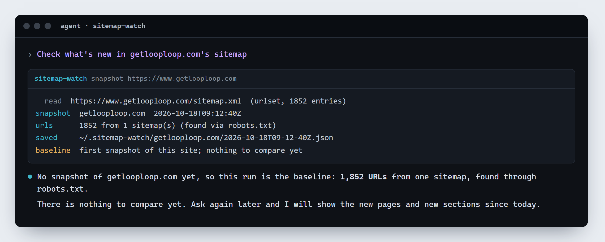
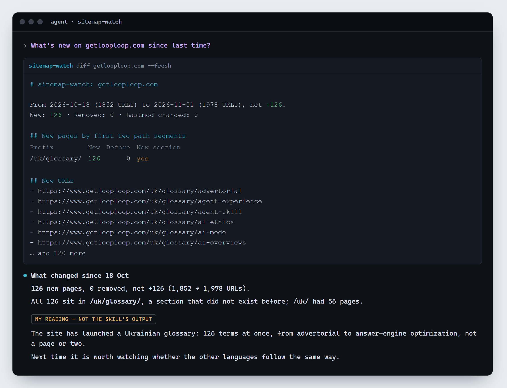

English · [Українська](README.uk.md) · [Polski](README.pl.md)

# Sitemap watch

What is new on a site, from its sitemaps. An Agent Skill for Claude Code, Codex, opencode, Hermes Agent and any agent that loads `SKILL.md` skills, from [GetLoopLoop](https://www.getlooploop.com).

Remembers which pages a site's sitemaps list and shows what changed since the last look: new pages, removed pages, changed `lastmod`, and the new pages grouped by section. Built for "what's new at my competitors": the script counts and compares, the agent says what the new sections suggest. Node built-ins only, no install.

Version **1.101**. Install it (below), then ask: **"check what's new at my competitors: example.com, example.org"**. The first run takes a baseline and says there is nothing to compare yet; every later run lists the new pages and the new sections. Snapshots are kept in `~/.sitemap-watch/<site>/`.





```
node skills/sitemap-watch/scripts/sitemap-watch.mjs snapshot example.com          # robots.txt → sitemaps (indexes, .xml.gz) → a stored list of URLs
node skills/sitemap-watch/scripts/sitemap-watch.mjs diff example.com --fresh      # a new snapshot, compared with the previous one
node skills/sitemap-watch/scripts/sitemap-watch.mjs diff example.com --from 2026-10-01 --json
node skills/sitemap-watch/scripts/sitemap-watch.mjs list example.com
```

It reads robots.txt and the sitemaps one request at a time with its own User-Agent, stops at 500 sitemaps and 200,000 URLs per snapshot, and says what it left out when it does. It never opens the pages themselves.

## Install

```
npx skills add Olexan-art/sitemap-watch --skill sitemap-watch
```

Or copy `skills/sitemap-watch` into your agent's skills folder (for Claude Code: `~/.claude/skills/sitemap-watch`). Node 18 or newer; nothing else to install.

## License

MIT. Made by [GetLoopLoop](https://www.getlooploop.com).
