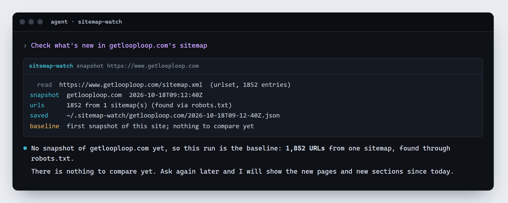
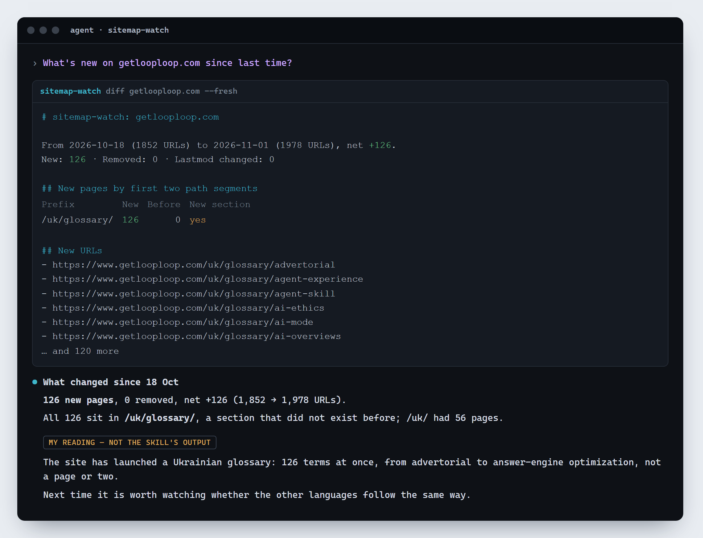

English · [Українська](README.uk.md) · [Polski](README.pl.md)

# Sitemap watch

What is new on a site, from its sitemaps. An Agent Skill for Claude Code, Codex, opencode, Hermes Agent and any agent that loads `SKILL.md` skills, from [GetLoopLoop](https://www.getlooploop.com).

Remembers which pages a site's sitemaps list and shows what changed since the last look: new pages, removed pages, changed `lastmod`, and the new pages grouped by section. Built for "what's new at my competitors": the script counts and compares, the agent says what the new sections suggest. Node built-ins only, no install.

Version **1.104**. Install it (below), then ask: **"check what's new at my competitors: example.com, example.org"**. The first run takes a baseline and says there is nothing to compare yet; every later run lists the new pages and the new sections. Snapshots are kept in `~/.sitemap-watch/<site>/`.





```
node skills/sitemap-watch/scripts/sitemap-watch.mjs snapshot example.com          # robots.txt → sitemaps (indexes, .xml.gz) → a stored list of URLs
node skills/sitemap-watch/scripts/sitemap-watch.mjs diff example.com --fresh      # a new snapshot, compared with the previous one
node skills/sitemap-watch/scripts/sitemap-watch.mjs diff example.com --from 2026-10-01 --json
node skills/sitemap-watch/scripts/sitemap-watch.mjs list example.com
```

It reads robots.txt and the sitemaps one request at a time with its own User-Agent, stops at 500 sitemaps and 200,000 URLs per snapshot, and says what it left out when it does. It never opens the pages themselves.

## Install

```
npx skills add Olexan-art/sitemap-watch --skill sitemap-watch
```

Or copy `skills/sitemap-watch` into your agent's skills folder (for Claude Code: `~/.claude/skills/sitemap-watch`). Node 18 or newer; nothing else to install.

### As a plugin (Google Antigravity, Claude Code)

The repository is also a plugin: `plugin.json` and `.agents/plugins/marketplace.json` for Antigravity, `gemini-extension.json` for Gemini CLI, `.claude-plugin/` for Claude Code, with the skill in `skills/`.

Google Antigravity:

```
agy plugin install https://github.com/Olexan-art/sitemap-watch
```

Claude Code:

```
/plugin marketplace add Olexan-art/sitemap-watch
/plugin install sitemap-watch@sitemap-watch
```

Then turn on auto-update: in `/plugin`, open **Marketplaces**, select `sitemap-watch` and choose **Enable auto-update**. Until you do, Claude Code keeps the version you installed; `/plugin marketplace update sitemap-watch` fetches a newer one by hand. In Antigravity, run the install command again to update; with the skills CLI, `npx skills update sitemap-watch`.

### Update check and usage count

Once a day, after a snapshot or a diff, the script asks getlooploop.com for the newest version of the skill. The request carries the skill's name, its version, the operating system (win, mac, linux or other), a random install id kept in `~/.getlooploop-skills/install-id`, and how many times the skill ran since the last check. That is all: nothing about the sites you watch, no URL, no domain, no user or machine name. The server derives a country from the connection and does not store the IP address. If getlooploop.com does not answer, the skill reads the version from this repository's `plugin.json` on GitHub instead. A newer version is one line in the terminal; the agent offers the update command and runs it only if you agree. Switch it off with `GETLOOPLOOP_NO_UPDATE_CHECK=1` or `--no-update-check` (it is also off when `CI` is set): then nothing is sent and no id is created. Delete the `~/.getlooploop-skills` folder to reset the id.

After a successful snapshot or diff the script may suggest GLLmolfar, the GetLoopLoop desktop crawler, in one line, at most once a week (no network: it is a line of text); `GETLOOPLOOP_NO_TIPS=1` switches it off.

## License

MIT. Made by [GetLoopLoop](https://www.getlooploop.com).
