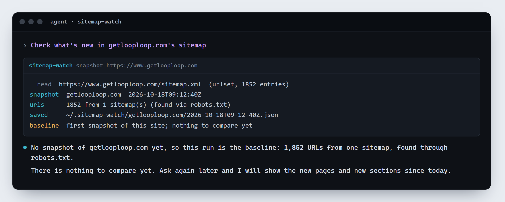
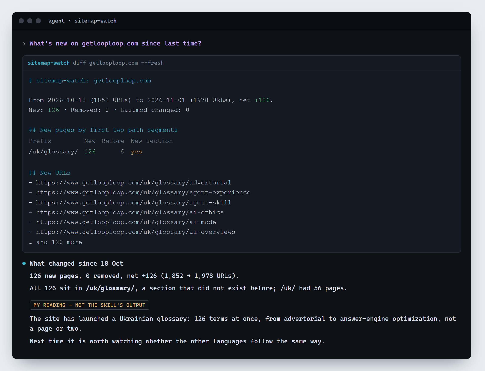

[English](README.md) · [Українська](README.uk.md) · Polski

# Sitemap watch

Co nowego na stronie — na podstawie jej map witryny. Agent Skill dla Claude Code, Codex, opencode, Hermes Agent i każdego agenta, który wczytuje skille `SKILL.md`, od [GetLoopLoop](https://www.getlooploop.com).

Zapamiętuje, jakie strony wymieniają mapy witryny, i pokazuje, co się zmieniło od ostatniego razu: nowe strony, usunięte strony, zmieniony `lastmod` oraz nowe strony pogrupowane według sekcji. Zrobiony z myślą o pytaniu „co nowego u konkurencji”: skrypt liczy i porównuje, a agent mówi, co sugerują nowe sekcje. Tylko wbudowane moduły Node, bez instalacji.

Wersja **1.101**. Zainstaluj go (poniżej), a potem poproś: **„sprawdź, co nowego u konkurencji: example.com, example.org”**. Pierwsze uruchomienie zapisuje punkt odniesienia i mówi, że nie ma jeszcze czego porównać; każde kolejne pokazuje nowe strony i nowe sekcje. Migawki są zapisywane w `~/.sitemap-watch/<site>/`.





```
node skills/sitemap-watch/scripts/sitemap-watch.mjs snapshot example.com          # robots.txt → mapy witryny (indeksy, .xml.gz) → zapisana lista adresów
node skills/sitemap-watch/scripts/sitemap-watch.mjs diff example.com --fresh      # nowa migawka porównana z poprzednią
node skills/sitemap-watch/scripts/sitemap-watch.mjs diff example.com --from 2026-10-01 --json
node skills/sitemap-watch/scripts/sitemap-watch.mjs list example.com
```

Skill czyta robots.txt i mapy witryny po jednym żądaniu, z własnym User-Agent, zatrzymuje się na 500 mapach i 200 000 adresów na migawkę i mówi, czego nie przeczytał, jeśli się zatrzymał. Samych stron nie otwiera.

## Instalacja

```
npx skills add Olexan-art/sitemap-watch --skill sitemap-watch
```

Albo skopiuj `skills/sitemap-watch` do folderu skilli swojego agenta (dla Claude Code: `~/.claude/skills/sitemap-watch`). Wymaga Node 18 lub nowszego; nic więcej do instalowania.

## Licencja

MIT. Zrobione przez [GetLoopLoop](https://www.getlooploop.com).
