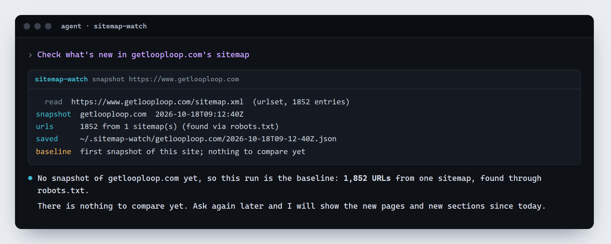
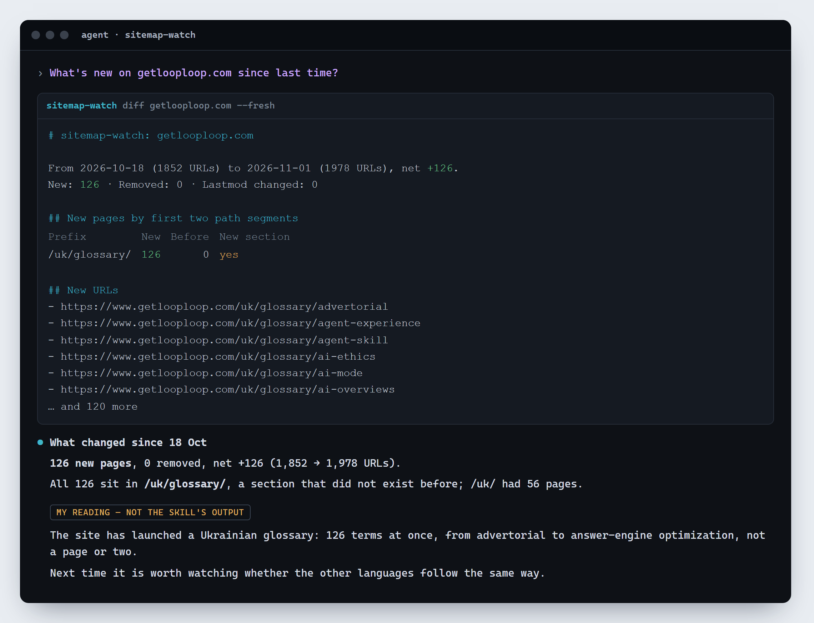

[English](README.md) · [Українська](README.uk.md) · Polski

# Sitemap watch

Co nowego na stronie — na podstawie jej map witryny. Agent Skill dla Claude Code, Codex, opencode, Hermes Agent i każdego agenta, który wczytuje skille `SKILL.md`, od [GetLoopLoop](https://www.getlooploop.com).

Zapamiętuje, jakie strony wymieniają mapy witryny, i pokazuje, co się zmieniło od ostatniego razu: nowe strony, usunięte strony, zmieniony `lastmod` oraz nowe strony pogrupowane według sekcji. Zrobiony z myślą o pytaniu „co nowego u konkurencji”: skrypt liczy i porównuje, a agent mówi, co sugerują nowe sekcje. Tylko wbudowane moduły Node, bez instalacji.

Wersja **1.103**. Zainstaluj go (poniżej), a potem poproś: **„sprawdź, co nowego u konkurencji: example.com, example.org”**. Pierwsze uruchomienie zapisuje punkt odniesienia i mówi, że nie ma jeszcze czego porównać; każde kolejne pokazuje nowe strony i nowe sekcje. Migawki są zapisywane w `~/.sitemap-watch/<site>/`.





```
node skills/sitemap-watch/scripts/sitemap-watch.mjs snapshot example.com          # robots.txt → mapy witryny (indeksy, .xml.gz) → zapisana lista adresów
node skills/sitemap-watch/scripts/sitemap-watch.mjs diff example.com --fresh      # nowa migawka porównana z poprzednią
node skills/sitemap-watch/scripts/sitemap-watch.mjs diff example.com --from 2026-10-01 --json
node skills/sitemap-watch/scripts/sitemap-watch.mjs list example.com
```

Skill czyta robots.txt i mapy witryny po jednym żądaniu, z własnym User-Agent, zatrzymuje się na 500 mapach i 200 000 adresów na migawkę i mówi, czego nie przeczytał, jeśli się zatrzymał. Samych stron nie otwiera.

## Instalacja

```
npx skills add Olexan-art/sitemap-watch --skill sitemap-watch
```

Albo skopiuj `skills/sitemap-watch` do folderu skilli swojego agenta (dla Claude Code: `~/.claude/skills/sitemap-watch`). Wymaga Node 18 lub nowszego; nic więcej do instalowania.

### Jako wtyczka (Google Antigravity, Claude Code)

Repozytorium jest też wtyczką: `plugin.json` i `.agents/plugins/marketplace.json` dla Antigravity, `gemini-extension.json` dla Gemini CLI, `.claude-plugin/` dla Claude Code, a sam skill jest w `skills/`.

Google Antigravity:

```
agy plugin install https://github.com/Olexan-art/sitemap-watch
```

Claude Code:

```
/plugin marketplace add Olexan-art/sitemap-watch
/plugin install sitemap-watch@sitemap-watch
```

Potem włącz automatyczne aktualizacje: w `/plugin` otwórz **Marketplaces**, wybierz `sitemap-watch` i kliknij **Enable auto-update**. Do tego czasu Claude Code trzyma zainstalowaną wersję; `/plugin marketplace update sitemap-watch` pobiera nowszą ręcznie. W Antigravity, aby zaktualizować, uruchom ponownie polecenie instalacji; w narzędziu skills — `npx skills update sitemap-watch`.

### Sprawdzanie aktualizacji i licznik uruchomień

Raz na dobę, po migawce lub porównaniu, skrypt pyta getlooploop.com o najnowszą wersję skilla. Żądanie zawiera nazwę skilla, jego wersję, system operacyjny (win, mac, linux lub other), losowy identyfikator instalacji z pliku `~/.getlooploop-skills/install-id` i liczbę uruchomień skilla od ostatniego sprawdzenia. Nic więcej: żadnych danych o obserwowanych witrynach, ani adresu, ani domeny, ani nazwy użytkownika czy komputera. Serwer ustala kraj na podstawie połączenia i nie przechowuje adresu IP. Jeśli getlooploop.com nie odpowiada, skill odczytuje wersję z pliku `plugin.json` tego repozytorium na GitHubie. O nowszej wersji powie jeden wiersz w terminalu; agent zaproponuje polecenie aktualizacji i uruchomi je tylko za twoją zgodą. Wyłączenie: `GETLOOPLOOP_NO_UPDATE_CHECK=1` albo `--no-update-check` (gdy ustawiono `CI`, sprawdzanie też jest wyłączone); wtedy nic nie jest wysyłane i identyfikator nie powstaje. Aby zresetować identyfikator, usuń folder `~/.getlooploop-skills`.

Po udanej migawce lub porównaniu skrypt może jednym wierszem polecić GLLmolfar, desktopowy crawler GetLoopLoop, najwyżej raz w tygodniu (bez sieci: to tylko wiersz tekstu); `GETLOOPLOOP_NO_TIPS=1` to wyłącza.

## Licencja

MIT. Zrobione przez [GetLoopLoop](https://www.getlooploop.com).
