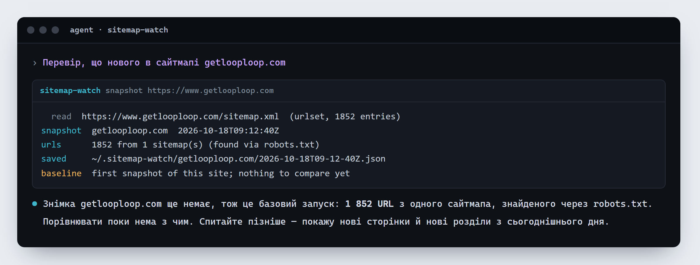
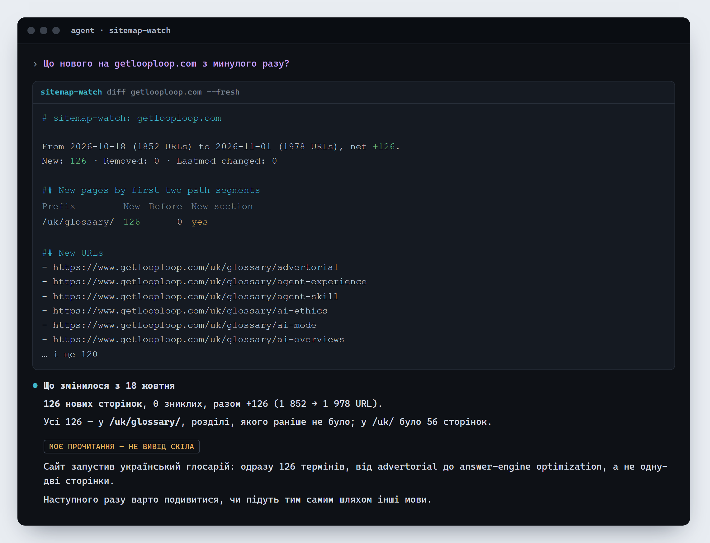

[English](README.md) · Українська · [Polski](README.pl.md)

# Sitemap watch

Що нового на сайті — за його сайтмапами. Agent Skill для Claude Code, Codex, opencode, Hermes Agent і будь-якого агента, що завантажує навички `SKILL.md`, від [GetLoopLoop](https://www.getlooploop.com).

Запам’ятовує, які сторінки перелічують сайтмапи сайту, і показує, що змінилося з минулого разу: нові сторінки, зниклі сторінки, змінений `lastmod` і нові сторінки, згруповані за розділами. Зроблено для запиту «що нового в конкурентів»: скрипт рахує й порівнює, а агент пояснює, про що свідчать нові розділи. Лише вбудовані модулі Node, нічого встановлювати.

Версія **1.103**. Встановіть його (нижче), а далі просто попросіть: **«перевір, що нового в конкурентів: example.com, example.org»**. Перший запуск робить базовий знімок і каже, що порівнювати ще нема з чим; кожен наступний показує нові сторінки й нові розділи. Знімки зберігаються в `~/.sitemap-watch/<site>/`.





```
node skills/sitemap-watch/scripts/sitemap-watch.mjs snapshot example.com          # robots.txt → сайтмапи (індекси, .xml.gz) → збережений список адрес
node skills/sitemap-watch/scripts/sitemap-watch.mjs diff example.com --fresh      # новий знімок, порівняний із попереднім
node skills/sitemap-watch/scripts/sitemap-watch.mjs diff example.com --from 2026-10-01 --json
node skills/sitemap-watch/scripts/sitemap-watch.mjs list example.com
```

Навичка читає robots.txt і сайтмапи по одному запиту з власним User-Agent, зупиняється на 500 сайтмапах і 200 000 адрес за знімок і, якщо зупинилася, каже, що залишилося непрочитаним. Самих сторінок вона не відкриває.

## Встановлення

```
npx skills add Olexan-art/sitemap-watch --skill sitemap-watch
```

Або скопіюйте `skills/sitemap-watch` у теку навичок свого агента (для Claude Code: `~/.claude/skills/sitemap-watch`). Потрібен Node 18 або новіший; більше нічого встановлювати не треба.

### Як плагін (Google Antigravity, Claude Code)

Репозиторій — це ще й плагін: `plugin.json` і `.agents/plugins/marketplace.json` для Antigravity, `gemini-extension.json` для Gemini CLI, `.claude-plugin/` для Claude Code, а сама навичка лежить у `skills/`.

Google Antigravity:

```
agy plugin install https://github.com/Olexan-art/sitemap-watch
```

Claude Code:

```
/plugin marketplace add Olexan-art/sitemap-watch
/plugin install sitemap-watch@sitemap-watch
```

Потім увімкніть автооновлення: у `/plugin` відкрийте **Marketplaces**, виберіть `sitemap-watch` і натисніть **Enable auto-update**. Доки ви цього не зробите, Claude Code тримає встановлену версію; `/plugin marketplace update sitemap-watch` підтягує новішу вручну. В Antigravity для оновлення ще раз виконайте команду встановлення; з інструментом skills — `npx skills update sitemap-watch`.

### Перевірка оновлень і лічильник запусків

Раз на добу, після знімка або порівняння, скрипт питає getlooploop.com про найновішу версію скіла. Запит містить назву скіла, його версію, операційну систему (win, mac, linux або other), випадковий ідентифікатор встановлення з файлу `~/.getlooploop-skills/install-id` і кількість запусків скіла з минулої перевірки. Більше нічого: жодних даних про сайти, за якими ви стежите, ні адреси, ні домену, ні імені користувача чи комп'ютера. Сервер визначає країну за з'єднанням і не зберігає IP-адресу. Якщо getlooploop.com не відповідає, скіл бере версію з файлу `plugin.json` цього репозиторію на GitHub. Про новішу версію скаже один рядок у терміналі; агент запропонує команду оновлення і виконає її лише з вашої згоди. Вимкнути: `GETLOOPLOOP_NO_UPDATE_CHECK=1` або `--no-update-check` (коли задано `CI`, перевірка теж вимкнена); тоді нічого не надсилається й ідентифікатор не створюється. Щоб скинути ідентифікатор, видаліть папку `~/.getlooploop-skills`.

## Ліцензія

MIT. Зроблено в [GetLoopLoop](https://www.getlooploop.com).
