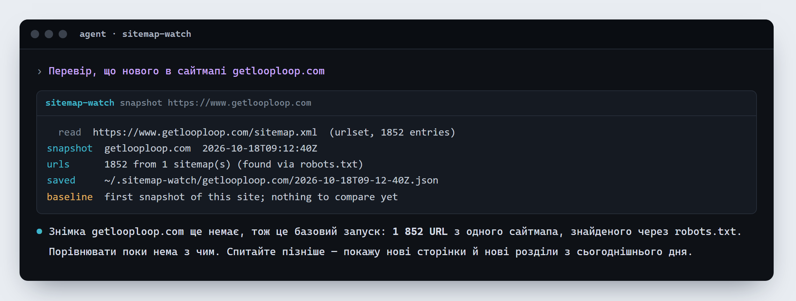
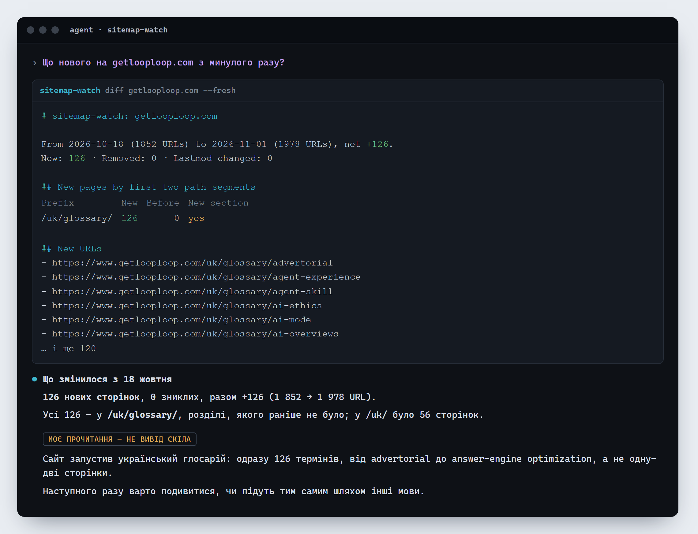

[English](README.md) · Українська · [Polski](README.pl.md)

# Sitemap watch

Що нового на сайті — за його сайтмапами. Agent Skill для Claude Code, Codex, opencode, Hermes Agent і будь-якого агента, що завантажує навички `SKILL.md`, від [GetLoopLoop](https://www.getlooploop.com).

Запам’ятовує, які сторінки перелічують сайтмапи сайту, і показує, що змінилося з минулого разу: нові сторінки, зниклі сторінки, змінений `lastmod` і нові сторінки, згруповані за розділами. Зроблено для запиту «що нового в конкурентів»: скрипт рахує й порівнює, а агент пояснює, про що свідчать нові розділи. Лише вбудовані модулі Node, нічого встановлювати.

Версія **1.101**. Встановіть його (нижче), а далі просто попросіть: **«перевір, що нового в конкурентів: example.com, example.org»**. Перший запуск робить базовий знімок і каже, що порівнювати ще нема з чим; кожен наступний показує нові сторінки й нові розділи. Знімки зберігаються в `~/.sitemap-watch/<site>/`.





```
node skills/sitemap-watch/scripts/sitemap-watch.mjs snapshot example.com          # robots.txt → сайтмапи (індекси, .xml.gz) → збережений список адрес
node skills/sitemap-watch/scripts/sitemap-watch.mjs diff example.com --fresh      # новий знімок, порівняний із попереднім
node skills/sitemap-watch/scripts/sitemap-watch.mjs diff example.com --from 2026-10-01 --json
node skills/sitemap-watch/scripts/sitemap-watch.mjs list example.com
```

Навичка читає robots.txt і сайтмапи по одному запиту з власним User-Agent, зупиняється на 500 сайтмапах і 200 000 адрес за знімок і, якщо зупинилася, каже, що залишилося непрочитаним. Самих сторінок вона не відкриває.

## Встановлення

```
npx skills add Olexan-art/sitemap-watch --skill sitemap-watch
```

Або скопіюйте `skills/sitemap-watch` у теку навичок свого агента (для Claude Code: `~/.claude/skills/sitemap-watch`). Потрібен Node 18 або новіший; більше нічого встановлювати не треба.

## Ліцензія

MIT. Зроблено в [GetLoopLoop](https://www.getlooploop.com).
